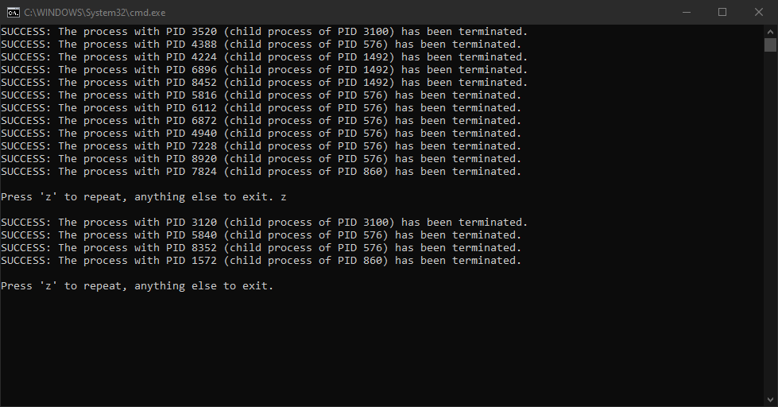

# Windows Process Cleaner

Batch script that kills unnecessary Windows processes to free up system resources.

## Overview

Batch script that kills unnecessary Windows processes to free up system resources. Only processes that were actually terminated get printed to the console. It's safe to run repeatedly, since everything restarts after a reboot anyway.

## Tech stack

- **Language:** Batch

## Installation

1. Download the latest `windows-process-cleaner.bat` from [Releases](https://github.com/mk-forge/windows-process-cleaner/releases).
2. Right-click it and choose **Run as administrator**.

> [!IMPORTANT]
> Without administrator privileges system processes won't terminate.

## Usage

Press `z` to scan and kill processes again, or any other key to exit.

## Screenshots

## License

[MIT](LICENSE)